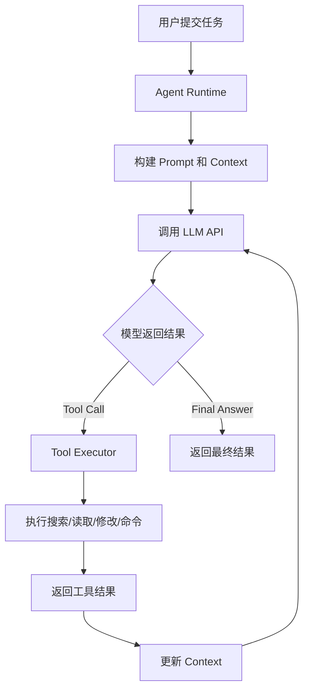

# AI Coding Agent 工作原理与技术体系

## 1. Augment Code 与 Codex 对比

Augment Code 和 Codex 都属于 AI Coding 工具，但在产品定位、代码理解、上下文管理和执行方式上存在一定差异。

| 对比维度 | Augment Code | Codex |
|---|---|---|
| 产品定位 | AI 编程助手、代码库理解与 Agent | AI Coding Agent |
| IDE 支持 | 深度集成 IDE | IDE、CLI、云端工作环境等 |
| CLI | Auggie CLI | Codex CLI |
| 代码库理解 | 强调代码库语义索引与上下文检索 | 结合文件检索、上下文分析和Agent执行 |
| 上下文获取 | Context Engine、代码索引、语义检索 | 文件读取、搜索、代码分析、上下文构建 |
| Agent 能力 | 支持自主执行开发任务 | 支持自主执行开发任务 |
| 工具调用 | 文件操作、命令执行等 | 文件操作、命令执行等 |
| 多轮执行 | 支持 | 支持 |
| 适用场景 | 大型代码库理解、企业项目开发 | 通用代码开发、任务执行、自动化编程 |

> 需要注意：不同版本的产品能力可能有所变化，以上是从整体架构与产品定位进行的概括性比较。

---

## 2. Auggie CLI 与 Codex CLI

Auggie CLI 是 Augment Code 提供的命令行 Agent，并不是必须依赖 IDE 才能运行。

因此，更合理的比较对象是：

- Auggie CLI
- Codex CLI

而不是单纯比较 IDE 插件。

CLI Agent 的典型特点：

- 在终端独立运行
- 可以读取当前项目
- 可以搜索代码
- 可以分析代码结构
- 可以修改文件
- 可以执行命令
- 可以运行测试
- 可以根据执行结果继续调整代码

例如：

```bash
auggie
```

进入 Agent 交互模式后，可以要求：

```text
分析当前 Spring Boot 项目中的支付模块。

找出 HTTP 请求没有配置连接超时和读取超时的地方，
分析可能造成的影响，并给出修复方案。

如果可以确认问题，请修改代码并运行相关测试。
```

Agent 会根据任务自主进行代码搜索、文件读取、分析和工具调用。

---

## 3. Augment Code 的 Context Engine

Augment Code 的一个重要特点是代码库上下文理解能力。

传统 AI 编程助手可能主要通过以下方式获取代码：

```text
用户问题
    ↓
搜索文件
    ↓
读取相关代码
    ↓
将代码放入上下文
    ↓
LLM 分析
```

而具备代码库语义索引能力的系统，通常可以通过更丰富的方式获取上下文：

```text
代码库
    ↓
代码解析 / 索引
    ↓
语义关联
    ↓
代码检索
    ↓
上下文排序
    ↓
构建 LLM 输入
```

可能涉及的技术：

- 代码索引
- AST 分析
- 代码符号分析
- Embedding
- 向量检索
- 语义搜索
- 代码依赖关系分析
- 上下文排序
- 增量索引

### 3.1 为什么语义索引很重要？

假设项目中存在：

```java
@RestController
public class PaymentController {

    private final PaymentService paymentService;

    public PaymentController(PaymentService paymentService) {
        this.paymentService = paymentService;
    }

    @PostMapping("/pay")
    public Result pay() {
        return paymentService.pay();
    }
}
```

```java
@Service
public class PaymentService {

    private final PaymentClient paymentClient;

    public PaymentService(PaymentClient paymentClient) {
        this.paymentClient = paymentClient;
    }

    public Result pay() {
        return paymentClient.execute();
    }
}
```

```java
@Component
public class PaymentClient {

    public Result execute() {
        // 调用第三方支付服务
        return new Result();
    }
}
```

当用户提出：

> 支付接口为什么会超时？

Agent 不应该只读取 `PaymentController`。

它需要理解：

```text
PaymentController
        ↓
PaymentService
        ↓
PaymentClient
        ↓
HTTP Client
        ↓
第三方支付服务
```

真正相关的代码可能分布在不同模块、不同文件甚至不同配置中。

代码库上下文检索的价值，就是尽可能帮助 Agent 找到这些相关信息。

---

## 4. 什么是 Context？

Context（上下文）是指模型完成当前任务时所需要的信息集合。

例如：

```text
用户问题：
为什么 PaymentService 调用偶尔超时？
```

模型可能需要：

```text
1. 用户的问题
2. 当前任务的要求
3. PaymentService 的代码
4. PaymentClient 的代码
5. HTTP Client 配置
6. 超时配置
7. 日志
8. 之前分析过的结论
9. 修改代码的约束
10. 测试结果
```

这些信息共同构成模型处理当前任务的 Context。

### 4.1 Context 不等于 Prompt

Prompt 通常指提交给模型的指令或输入内容。

Context 则更强调模型当前任务所依赖的信息。

例如：

```text
Prompt：

请分析 PaymentService 为什么会出现超时。
```

Context：

```text
Prompt
+
PaymentService.java
+
PaymentClient.java
+
application.yml
+
日志
+
之前的分析结论
```

因此，Context 可以包含 Prompt，也可以包含其他任务信息。

---

## 5. Context 最终表现形式是 Token 吗？

从模型的实际输入角度来看，是的。

模型接收到的文本最终会通过 Tokenizer 转换为 Token ID 序列。

例如：

```text
原始文本：

请分析 PaymentService 的超时问题。
```

经过 Tokenizer 后，可能变成：

```text
[1523, 6841, 102, 3928, 821, ...]
```

实际 Token 数量和编号取决于具体模型的 Tokenizer。

因此可以理解为：

```text
Context
    ↓
文本 / 代码 / 图片 / 其他信息
    ↓
Tokenizer
    ↓
Token ID
    ↓
模型计算
    ↓
输出
```

### 5.1 Token 与 Context Window

Token：

模型处理信息的基本单位。

Context Window：

模型一次处理任务时能够容纳的上下文容量。

例如，某个模型支持 128K Token Context Window。

这并不意味着模型每次必须接收 128K Token，而是表示其上下文容量上限。

实际输入可能只有：

```text
System Prompt        2K
User Prompt         1K
代码文件            20K
历史消息            10K
工具结果            5K
```

总计：

```text
38K Tokens
```

如果持续执行 Agent 任务，随着工具调用和历史结果增加，Context 可能不断膨胀。

---

## 6. Prompt Engineering

Prompt Engineering 是设计和优化模型输入指令的过程。

主要目的：

- 明确任务
- 限定目标
- 提供背景
- 指定约束
- 指定输出格式
- 提供示例
- 减少歧义
- 提高模型输出质量

### 6.1 不好的 Prompt

```text
优化一下支付模块。
```

问题：

- 不知道优化什么
- 不知道是否允许修改代码
- 不知道是否需要兼容现有接口
- 不知道是否需要运行测试
- 不知道优化的优先级

### 6.2 更好的 Prompt

```text
请分析当前 Spring Boot 项目的支付模块。

要求：

1. 分析支付请求的调用链。
2. 检查 HTTP Client 的连接超时和读取超时配置。
3. 检查异常处理机制。
4. 检查是否存在不合理的重试策略。
5. 不要修改公共接口。
6. 如果发现明确问题，给出修改方案。
7. 修改后运行相关测试。

输出：

- 问题分析
- 影响范围
- 修改方案
- 修改文件
- 测试结果
```

通过明确任务目标、约束条件和输出格式，可以使模型的执行结果更加稳定。

---

## 7. Prompt Engineering 与 Context Engineering

二者解决的问题不同。

### Prompt Engineering

关注：

```text
如何向模型表达任务？
```

例如：

- 任务描述
- 指令
- 角色
- 输出格式
- 约束条件
- 示例

### Context Engineering

关注：

```text
如何为模型准备正确的信息？
```

例如：

- 搜索哪些文件
- 读取哪些代码
- 哪些日志有价值
- 如何筛选历史消息
- 如何控制 Token
- 如何排序上下文
- 如何压缩上下文

可以理解为：

```text
Prompt Engineering
    ↓
告诉模型应该做什么

Context Engineering
    ↓
提供模型完成任务所需要的信息
```

对于 Coding Agent 来说，Context Engineering 往往非常重要。

因为模型本身可能具有很强的代码能力，但如果没有获取到正确的项目代码，它仍然无法准确完成任务。

---

## 8. Agent 是如何调用 LLM API 的？

一个 Coding Agent 通常不只是简单地调用一次 LLM API。

更完整的架构可能是：

```text
用户
 │
 ▼
Agent Runtime
 │
 ├── Prompt Builder
 │
 ├── Context Manager
 │
 ├── Tool Executor
 │
 ├── State Manager
 │
 └── LLM Client
        │
        ▼
       LLM
```

### 8.1 Agent Runtime

Agent Runtime 是 Agent 的执行环境。

负责：

- 接收用户任务
- 构建 Prompt
- 管理上下文
- 调用 LLM
- 解析模型返回结果
- 执行 Tool Calling
- 管理执行状态
- 将工具结果反馈给模型
- 判断任务是否完成

LLM 本身主要负责推理、规划和决定下一步动作。

实际读取文件、修改文件、执行 Shell 命令等操作，通常由 Agent Runtime 提供的工具执行器完成。

---

## 9. Agent Tool Calling

假设 Agent 提供以下工具：

```json
[
  {
    "name": "search_code",
    "description": "搜索代码"
  },
  {
    "name": "read_file",
    "description": "读取文件"
  },
  {
    "name": "edit_file",
    "description": "修改文件"
  },
  {
    "name": "run_command",
    "description": "执行命令"
  }
]
```

这些工具会被定义为模型可调用的工具。

模型并不是直接执行这些方法，而是返回一个 Tool Call 请求。

例如：

```json
{
  "tool_calls": [
    {
      "name": "search_code",
      "arguments": {
        "query": "PaymentService"
      }
    }
  ]
}
```

Agent Runtime 收到请求后：

```text
LLM
    ↓
返回 Tool Call
    ↓
Agent Runtime
    ↓
执行 search_code
    ↓
返回搜索结果
    ↓
重新提交给 LLM
```

---

## 10. Agent 完整执行示例

用户任务：

```text
分析 PaymentService 偶发超时问题。

检查 HTTP Client 是否配置连接超时和读取超时。

如果存在明确问题，请修复并运行测试。
```

### 第一阶段：构建上下文

Agent Runtime 首先构建初始上下文。

```text
System Prompt
+
用户任务
+
项目结构信息
+
可用工具定义
+
必要的历史消息
```

### 第二阶段：第一次 LLM API 调用

Agent 提交请求：

```json
{
  "messages": [
    {
      "role": "system",
      "content": "你是一个 Java Coding Agent。你可以使用工具搜索代码、读取文件、修改代码和执行命令。"
    },
    {
      "role": "user",
      "content": "分析 PaymentService 偶发超时问题，检查 HTTP Client 超时配置，必要时修复并运行测试。"
    }
  ],
  "tools": [
    {
      "name": "search_code"
    },
    {
      "name": "read_file"
    },
    {
      "name": "edit_file"
    },
    {
      "name": "run_command"
    }
  ]
}
```

模型可能返回：

```json
{
  "tool_calls": [
    {
      "name": "search_code",
      "arguments": {
        "query": "PaymentService"
      }
    }
  ]
}
```

Agent Runtime 执行搜索。

### 第三阶段：搜索代码

工具执行：

```bash
grep -R "PaymentService" .
```

搜索结果：

```text
payment-service/src/main/java/PaymentService.java
payment-service/src/main/java/PaymentClient.java
payment-service/src/main/resources/application.yml
```

Agent 将搜索结果追加到上下文。

### 第四阶段：读取 PaymentService

模型请求：

```json
{
  "tool_calls": [
    {
      "name": "read_file",
      "arguments": {
        "path": "payment-service/src/main/java/PaymentService.java"
      }
    }
  ]
}
```

Agent Runtime 读取文件后返回：

```java
@Service
public class PaymentService {

    private final PaymentClient paymentClient;

    public PaymentService(PaymentClient paymentClient) {
        this.paymentClient = paymentClient;
    }

    public Result pay() {
        return paymentClient.execute();
    }
}
```

模型发现 PaymentService 本身没有直接的 HTTP 请求逻辑。

于是继续分析 PaymentClient。

### 第五阶段：读取 HTTP Client

Agent 请求：

```json
{
  "tool_calls": [
    {
      "name": "read_file",
      "arguments": {
        "path": "payment-service/src/main/java/PaymentClient.java"
      }
    }
  ]
}
```

读取结果：

```java
@Component
public class PaymentClient {

    public Result execute() {
        // HTTP 请求
        return request();
    }
}
```

Agent 继续搜索 HTTP Client 配置。

### 第六阶段：读取配置

读取：

```yaml
spring:
  application:
    name: payment-service
```

假设当前项目缺少明确的连接超时和读取超时配置。

Agent 进一步检查：

- HTTP Client 类型
- 配置绑定情况
- 当前依赖版本
- 默认超时行为
- 是否存在其他超时设置

确认问题后，模型决定修改配置。

### 第七阶段：修改代码

模型返回工具请求：

```json
{
  "tool_calls": [
    {
      "name": "edit_file",
      "arguments": {
        "path": "payment-service/src/main/resources/application.yml",
        "changes": "添加 HTTP Client 超时配置"
      }
    }
  ]
}
```

Agent Runtime 执行文件修改。

例如，假设项目使用对应版本的 Spring Boot HTTP Client 配置：

```yaml
http-client:
  connect-timeout: 2s
  read-timeout: 4s
```

> 以上配置仅用于示意。实际配置项需要根据项目使用的 HTTP Client、Spring Boot 版本以及配置绑定代码确定，不能直接认为该 YAML 会自动生效。

### 第八阶段：运行测试

模型决定运行测试：

```json
{
  "tool_calls": [
    {
      "name": "run_command",
      "arguments": {
        "command": "mvn test -pl payment-service"
      }
    }
  ]
}
```

Agent Runtime 执行命令。

测试结果：

```text
Tests run: 42
Failures: 0
Errors: 0
BUILD SUCCESS
```

执行结果再次返回给模型。

### 第九阶段：最终总结

模型结合：

- 原始问题
- 搜索结果
- 读取的代码
- 修改结果
- 测试结果

生成最终回答：

```text
问题分析：

PaymentService 本身未直接执行 HTTP 请求，
实际请求由 PaymentClient 执行。

检查过程中发现 HTTP Client 缺少明确的超时配置，
可能导致请求在异常情况下等待过长时间。

修改：

补充 HTTP Client 超时配置。

测试：

mvn test -pl payment-service

结果：

BUILD SUCCESS
42 个测试通过。
```

---

## 11. Agent 执行流程图



Agent 本质上是一个循环执行系统。

核心逻辑可以简化为：

```java
while (true) {

    // 1. 构建当前上下文
    List<Message> messages = contextManager.buildMessages();

    // 2. 调用 LLM
    LLMResponse response = llmClient.call(messages, tools);

    // 3. 判断是否需要执行工具
    if (response.hasToolCalls()) {

        // 4. 执行工具
        ToolResult result = toolExecutor.execute(
                response.getToolCalls()
        );

        // 5. 将工具结果追加到上下文
        contextManager.addToolResult(result);

        // 6. 继续下一轮
        continue;
    }

    // 7. 返回最终答案
    return response.getFinalAnswer();
}
```

这就是 Agent 最核心的执行循环。

---

## 12. Agent 如何维护上下文？

LLM API 通常并不会自动记住之前所有调用的内容。

如果 Agent 需要连续执行多个步骤，就需要由 Agent Runtime 管理上下文。

### 12.1 无状态 API 调用

每次请求都需要提交当前所需的消息：

```json
{
  "messages": [
    {
      "role": "system",
      "content": "你是 Java Coding Agent"
    },
    {
      "role": "user",
      "content": "分析 PaymentService 超时问题"
    },
    {
      "role": "assistant",
      "tool_calls": [
        {
          "name": "search_code",
          "arguments": {
            "query": "PaymentService"
          }
        }
      ]
    },
    {
      "role": "tool",
      "content": "搜索结果：PaymentService.java、PaymentClient.java"
    },
    {
      "role": "assistant",
      "tool_calls": [
        {
          "name": "read_file",
          "arguments": {
            "path": "PaymentService.java"
          }
        }
      ]
    },
    {
      "role": "tool",
      "content": "PaymentService 文件内容..."
    }
  ]
}
```

下一次 API 调用时，Agent Runtime 会根据需要继续提交历史消息和新增工具结果。

### 12.2 Context Manager

随着 Agent 执行时间增长，上下文可能越来越大。

Context Manager 需要管理：

```text
System Prompt
用户任务
代码内容
工具调用记录
工具返回结果
历史分析
最终执行状态
```

当 Context 过大时，可以进行：

- 删除无用工具输出
- 清理重复代码
- 压缩历史对话
- 总结已完成步骤
- 保留重要结论
- 重新检索需要的文件

例如，将历史工具调用压缩为：

```text
任务：

排查 PaymentService 偶发超时。

已完成：

1. 找到 PaymentService。
2. 确认实际 HTTP 请求由 PaymentClient 发起。
3. 检查 HTTP Client 配置。
4. 发现缺少明确超时设置。
5. 补充配置。
6. 测试通过。

当前结论：

修改已经完成，暂时没有其他待处理步骤。
```

这可以减少 Token 消耗，并让模型继续执行后续任务。

---

## 13. Agent、LLM、Tool 的关系

```text
Agent
    │
    ├── LLM
    │      ├── 理解任务
    │      ├── 推理
    │      ├── 规划
    │      └── 决定下一步
    │
    ├── Context Manager
    │      ├── 管理历史
    │      ├── 管理代码上下文
    │      └── 控制 Token
    │
    ├── Tool Executor
    │      ├── 搜索文件
    │      ├── 读取文件
    │      ├── 修改文件
    │      └── 执行命令
    │
    └── State Manager
           ├── 管理任务状态
           ├── 管理执行步骤
           └── 管理任务完成状态
```

LLM 是 Agent 的推理核心，但 Agent 并不等于 LLM。

一个完整的 Agent 系统还包括：

- 执行环境
- 工具
- 上下文管理
- 状态管理
- 任务循环
- 安全限制
- 权限管理

---

## 14. 总结

AI Coding Agent 的核心不只是调用一个大模型 API。

完整流程是：

```text
用户提出任务
    ↓
Agent 理解任务
    ↓
构建 Prompt
    ↓
检索相关 Context
    ↓
调用 LLM
    ↓
LLM 进行推理
    ↓
返回 Tool Call
    ↓
Agent Runtime 执行工具
    ↓
获取执行结果
    ↓
更新 Context
    ↓
再次调用 LLM
    ↓
继续执行
    ↓
任务完成
    ↓
生成最终结果
```

可以将整个体系理解为：

- **LLM**：负责理解、推理、规划和决策。
- **Prompt Engineering**：设计模型的任务指令。
- **Context Engineering**：为模型准备正确的信息。
- **Tool Calling**：模型请求执行外部操作的机制。
- **Agent Runtime**：负责执行工具、维护状态和组织任务循环。
- **Agent**：将 LLM、Context、Tools 和 Runtime 组合起来，使模型能够持续完成复杂任务。

真正决定一个 Coding Agent 能力的，不只是模型本身，还包括代码检索能力、上下文管理能力、工具执行能力、任务规划能力以及整个执行闭环的设计。
