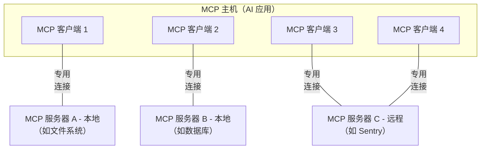

# 什么是模型上下文协议（MCP）？

*来源：https://modelcontextprotocol.io/docs/2026-07-28/getting-started/intro（文档版本 2026-07-28）*

MCP（Model Context Protocol，模型上下文协议）是一个开源标准，用于将 AI 应用连接到外部系统。

借助 MCP，Claude、ChatGPT 等 AI 应用可以连接数据源（如本地文件、数据库）、工具（如搜索引擎、计算器）和工作流（如专用提示词），从而获取关键信息并执行任务。

可以把 MCP 想象成 AI 应用的 USB-C 接口。正如 USB-C 为连接各种电子设备提供了标准化方式，MCP 也为连接 AI 应用与外部系统提供了标准化方式。

## MCP 能实现什么？

- 智能体可以访问你的 Google 日历和 Notion，成为更个性化的 AI 助手。
- Claude Code 可以根据 Figma 设计稿生成完整的 Web 应用。
- 企业聊天机器人可以连接组织内的多个数据库，让用户通过对话分析数据。
- AI 模型可以在 Blender 中创建 3D 设计，并通过 3D 打印机打印出来。

## MCP 为什么重要？

在生态系统中所处位置不同，MCP 带来的好处也不同：

- **开发者**：在构建 AI 应用或智能体，或与之集成时，MCP 可以缩短开发时间、降低复杂度。
- **AI 应用或智能体**：MCP 让它们接入由数据源、工具和应用组成的生态，增强能力并改善终端用户体验。
- **终端用户**：MCP 让 AI 应用或智能体更强大，必要时可以访问用户数据并代表用户执行操作。

## 广泛的生态支持

MCP 是一个开放协议，被众多客户端和服务器支持。[Claude](https://claude.com/docs/connectors/building)、[ChatGPT](https://developers.openai.com/api/docs/mcp/) 等 AI 助手，以及 [Visual Studio Code](https://code.visualstudio.com/docs/copilot/chat/mcp-servers)、[Cursor](https://cursor.com/docs/context/mcp)、[MCPJam](https://docs.mcpjam.com/getting-started) 等开发工具都支持 MCP。这让你可以一次构建，到处集成。


---

# 架构概览

*来源：https://modelcontextprotocol.io/docs/2026-07-28/learn/architecture（文档版本 2026-07-28）*

本文概述模型上下文协议（MCP）的[范围](#范围)和[核心概念](#mcp-的概念)，并提供一个演示每个核心概念的[示例](#示例)。

由于 MCP SDK 已经屏蔽了许多细节，大多数开发者会发现[数据层协议](#数据层协议)一节最有用，它讨论了 MCP 服务器如何向 AI 应用提供上下文。

具体实现细节请参阅你所用[语言对应 SDK](https://modelcontextprotocol.io/docs/2026-07-28/sdk) 的文档。

## 范围

模型上下文协议包含以下项目：

- [MCP 规范](https://modelcontextprotocol.io/specification/latest)：MCP 的规范文档，列出了客户端和服务器的实现要求。
- [MCP SDK](https://modelcontextprotocol.io/docs/2026-07-28/sdk)：各种编程语言中实现 MCP 的 SDK。
- **MCP 开发工具**：用于开发 MCP 服务器和客户端的工具，包括 [MCP Inspector](https://github.com/modelcontextprotocol/inspector)。
- [MCP 参考服务器实现](https://github.com/modelcontextprotocol/servers)：MCP 服务器的参考实现。

> **注意**：MCP 只关注上下文交换的协议本身，不规定 AI 应用如何使用 LLM，也不规定如何管理所提供的上下文。

## MCP 的概念

### 参与者

MCP 采用客户端-服务器架构。MCP 主机（MCP host）是 [Claude Code](https://www.anthropic.com/claude-code) 或 [Claude Desktop](https://www.claude.ai/download) 这类 AI 应用，它与一个或多个 MCP 服务器建立连接。主机的做法是：为每个 MCP 服务器创建一个 MCP 客户端，每个 MCP 客户端与其对应的 MCP 服务器保持一条专用连接。

使用 STDIO 传输的本地 MCP 服务器通常只服务一个 MCP 客户端，而使用 Streamable HTTP 传输的远程 MCP 服务器通常会服务多个 MCP 客户端。

MCP 架构中的关键参与者有：

- **MCP 主机**：协调和管理一个或多个 MCP 客户端的 AI 应用
- **MCP 客户端**：与 MCP 服务器保持连接的组件，从服务器获取上下文供 MCP 主机使用
- **MCP 服务器**：向 MCP 客户端提供上下文的程序

**举例**：Visual Studio Code 是一个 MCP 主机。当它连接到某个 MCP 服务器（例如 [Sentry MCP 服务器](https://docs.sentry.io/product/sentry-mcp/)）时，VS Code 运行时会实例化一个 MCP 客户端对象，用来维持与 Sentry MCP 服务器的连接。之后当 VS Code 再连接另一个 MCP 服务器（例如[本地文件系统服务器](https://github.com/modelcontextprotocol/servers/tree/main/src/filesystem)）时，运行时会再实例化一个 MCP 客户端对象来维持这条连接。



注意，**MCP 服务器**指的是提供上下文数据的程序，与它在哪里运行无关。MCP 服务器可以在本地或远程运行。例如，Claude Desktop 启动[文件系统服务器](https://github.com/modelcontextprotocol/servers/tree/main/src/filesystem)时，由于它使用 STDIO 传输，服务器就在同一台机器上本地运行，这通常称为“本地”MCP 服务器。官方的 [Sentry MCP 服务器](https://docs.sentry.io/product/sentry-mcp/)运行在 Sentry 平台上，使用 Streamable HTTP 传输，这通常称为“远程”MCP 服务器。

### 分层

MCP 由两层组成：

- **数据层**：定义基于 JSON-RPC 的客户端-服务器通信协议，包括能力与版本发现，以及工具、资源、提示词和通知等核心原语。
- **传输层**：定义客户端与服务器之间交换数据的通信机制和通道，包括与传输方式相关的连接建立、消息分帧和授权。

从概念上讲，数据层是内层，传输层是外层。

#### 数据层

数据层实现了基于 [JSON-RPC 2.0](https://www.jsonrpc.org/) 的交换协议，定义消息结构和语义。这一层包括：

- **发现（Discovery）**：客户端可通过 `server/discover` 请求查询服务器支持的协议版本、能力和身份信息
- **服务器特性**：让服务器提供核心功能，包括用于 AI 操作的工具、用于上下文数据的资源，以及用于交互模板的提示词
- **客户端特性**：让服务器可以向用户征求输入（elicitation）。自协议版本 `2026-07-28` 起，采样（sampling）已[弃用](https://modelcontextprotocol.io/specification/2026-07-28/deprecated)。
- **实用特性**：支持额外能力，例如用于实时更新的通知，以及长时间运行操作的进度跟踪

#### 传输层

传输层管理客户端与服务器之间的通信通道和身份认证，负责连接建立、消息分帧以及 MCP 参与者之间的安全通信。

MCP 支持两种传输机制：

- **Stdio 传输**：使用标准输入/输出流，在同一台机器上的本地进程之间直接通信，没有网络开销，性能最优。
- **Streamable HTTP 传输**：客户端到服务器的消息使用 HTTP POST，并可选用 Server-Sent Events 实现流式传输。这种传输支持远程服务器通信，并支持标准 HTTP 认证方式，包括 bearer token、API key 和自定义请求头。MCP 推荐使用 OAuth 来获取认证令牌。

传输层把通信细节从协议层抽象出来，使所有传输机制都使用相同的 JSON-RPC 2.0 消息格式。

### 数据层协议

MCP 的核心部分是定义 MCP 客户端与服务器之间的模式（schema）和语义。开发者很可能会觉得数据层，尤其是其中的[原语](#原语primitives)集合，是 MCP 中最有意思的部分，因为它定义了开发者如何把上下文从 MCP 服务器共享给 MCP 客户端。

MCP 使用 [JSON-RPC 2.0](https://www.jsonrpc.org/) 作为底层 RPC 协议。客户端和服务器相互发送请求并作出响应；不需要响应时可以使用通知。

#### 无状态与发现

MCP 是一个**无状态协议**（每个请求都包含处理它所需的全部信息，服务器不会从之前的请求中推断任何内容）。每个请求都在 `_meta` 字段中携带协议版本以及与该请求相关的**能力**（客户端或服务器支持的特性和操作，如工具、资源或提示词），因此服务器可以独立处理每个请求。除非另行配置，客户端也应在同一字段中标明自己的身份。服务器通过必须实现的 [`server/discover`](https://modelcontextprotocol.io/specification/2026-07-28/server/discover) 请求声明其支持的版本和能力，客户端可以在任何其他请求之前发送该请求。更多细节见[规范](https://modelcontextprotocol.io/specification/2026-07-28/basic/index#statelessness)，[示例](#示例)中展示了每个请求的元数据和发现流程。

#### 原语（Primitives）

MCP 原语是 MCP 中最重要的概念。它们定义了客户端和服务器能向对方提供什么，规定了可以与 AI 应用共享的上下文信息类型，以及可以执行的操作范围。

MCP 定义了*服务器*可以公开的三种核心原语：

- **工具（Tools）**：AI 应用可以调用以执行操作的可执行函数（如文件操作、API 调用、数据库查询）
- **资源（Resources）**：为 AI 应用提供上下文信息的数据源（如文件内容、数据库记录、API 响应）
- **提示词（Prompts）**：帮助组织与语言模型交互的可复用模板（如系统提示词、少样本示例）

每种原语都有对应的发现方法（`*/list`）、获取方法（`*/get`），某些情况下还有执行方法（`tools/call`）。MCP 客户端使用 `*/list` 方法来发现可用的原语。例如，客户端可以先列出所有可用工具（`tools/list`），再去执行它们。这种设计使列表可以是动态的。

举一个具体例子：一个提供数据库上下文的 MCP 服务器，可以公开用于查询数据库的工具、包含数据库模式的资源，以及包含与这些工具交互的少样本示例的提示词。

关于服务器原语的更多细节，请参阅[服务器概念](https://modelcontextprotocol.io/docs/2026-07-28/learn/server-concepts)。

MCP 还定义了*客户端*可以公开的原语，让 MCP 服务器作者能构建更丰富的交互。

- **征求输入（Elicitation）**：允许服务器向用户请求额外信息。当服务器作者想从用户那里获取更多信息，或请求用户确认某个操作时，这很有用。服务器通过 `elicitation/create` 方法请求用户输入。

征求输入的请求通过[多轮往返请求（Multi Round-Trip Requests）](https://modelcontextprotocol.io/specification/2026-07-28/basic/patterns/mrtr)模式传递，详见[征求输入概述](https://modelcontextprotocol.io/docs/2026-07-28/learn/client-concepts#elicitation)。

**已弃用**：以下客户端原语自协议版本 `2026-07-28` 起已弃用。

- **采样（Sampling）**：允许服务器向客户端的 AI 应用请求语言模型补全。当服务器作者希望使用语言模型，又想保持与模型无关、不在 MCP 服务器中引入语言模型 SDK 时，这很有用。服务器通过 `sampling/createMessage` 方法请求补全，同样通过多轮往返请求模式传递。新的实现应直接对接 LLM 提供商的 API。
- **日志（Logging）**：允许服务器向客户端发送日志消息，用于调试和监控。新的实现应将日志输出到 `stderr`（stdio 传输），或使用 OpenTelemetry。

关于客户端原语的更多细节，请参阅[客户端概念](https://modelcontextprotocol.io/docs/2026-07-28/learn/client-concepts)。

除服务器和客户端原语外，协议还支持建立在核心协议之上的可选[扩展](https://modelcontextprotocol.io/extensions/overview)。例如，[Tasks 扩展](https://modelcontextprotocol.io/extensions/tasks/overview)让服务器可以为长时间运行的请求返回一个持久句柄，客户端之后可以轮询状态并获取结果。

#### 通知（Notifications）

协议支持实时通知，使服务器与客户端之间可以动态更新。例如，当服务器可用的工具发生变化（比如有新功能可用或现有工具被修改）时，服务器可以发送工具更新通知，告知已连接的客户端。通知以 JSON-RPC 2.0 通知消息的形式发送（不期待响应）。变更通知是按需订阅的：客户端打开一个长连接的 [`subscriptions/listen`](https://modelcontextprotocol.io/specification/2026-07-28/basic/patterns/subscriptions) 流，指明想接收的通知类型，服务器就在该流上投递匹配的通知。


## 示例

### 数据层

本节以数据层协议为重点，逐步演示一次 MCP 客户端与服务器的交互。我们将用 JSON-RPC 2.0 消息展示发现、工具操作和通知。

**1. 发现（Discovery）**

如[无状态与发现](#无状态与发现)一节所述，每个 MCP 请求都在 `_meta` 字段中携带协议版本和客户端能力，客户端还应在其中带上自己的身份。如果客户端想在发出其他请求之前先了解服务器支持什么，可以发送 `server/discover` 请求，每个服务器都必须实现它。发现响应通常可以缓存，也就是可以复用，因此不需要为每个请求都执行一次发现流程。

Discover 请求：

```json
{
  "jsonrpc": "2.0",
  "id": 1,
  "method": "server/discover",
  "params": {
    "_meta": {
      "io.modelcontextprotocol/protocolVersion": "2026-07-28",
      "io.modelcontextprotocol/clientInfo": {
        "name": "example-client",
        "version": "1.0.0"
      },
      "io.modelcontextprotocol/clientCapabilities": {
        "elicitation": {}
      }
    }
  }
}
```

Discover 响应：

```json
{
  "jsonrpc": "2.0",
  "id": 1,
  "result": {
    "resultType": "complete",
    "supportedVersions": ["2026-07-28"],
    "capabilities": {
      "tools": {
        "listChanged": true
      },
      "resources": {}
    },
    "_meta": {
      "io.modelcontextprotocol/serverInfo": {
        "name": "example-server",
        "version": "1.0.0"
      }
    },
    "ttlMs": 3600000,
    "cacheScope": "public"
  }
}
```

#### 理解发现交换

`_meta` 字段和发现响应共同起到以下几个作用：

1. **协议版本选择**：`io.modelcontextprotocol/protocolVersion` 字段声明客户端在本次请求中使用的版本，响应中的 `supportedVersions` 列出服务器接受的版本。如果服务器不支持请求的版本，会返回 `UnsupportedProtocolVersionError` 拒绝该请求，并列出它支持的版本，客户端再用双方都支持的版本重试。

2. **能力发现**：客户端在每个请求的 `io.modelcontextprotocol/clientCapabilities` 中声明自己的能力，服务器则通过 `server/discover` 返回自己的 `capabilities` 对象。这让双方知道对方能处理哪些[原语](#原语primitives)（工具、资源、提示词），以及是否提供变更[通知](#通知notifications)，从而避免尝试不支持的操作。

3. **身份交换**：请求 `_meta` 中的 `io.modelcontextprotocol/clientInfo` 与结果 `_meta` 中的 `io.modelcontextprotocol/serverInfo` 提供标识和版本信息，用于调试和兼容性判断。

在这个例子中，交换过程演示了 MCP 能力是如何声明的：

**客户端能力**：

- `"elicitation": {}`：客户端声明，当服务器请求时，它可以向用户收集额外输入

**服务器能力**：

- `"tools": {"listChanged": true}`：服务器支持工具原语，并且可以响应 [`subscriptions/listen`](https://modelcontextprotocol.io/specification/2026-07-28/basic/patterns/subscriptions) 中的 `toolsListChanged` 过滤器。请求了该过滤器的客户端会在工具列表变化时收到 `notifications/tools/list_changed`。
- `"resources": {}`：服务器同样支持资源原语（可以处理 `resources/list` 和 `resources/read` 方法）

调用 `server/discover` 是可选的。由于每个请求都携带相同的 `_meta` 字段，客户端可以直接发送任意请求，如果返回版本错误再处理即可。发现只是用一次请求就获取服务器身份、能力和支持版本的便捷方式。

#### 在 AI 应用中如何工作

AI 应用的 MCP 客户端管理器连接到已配置的服务器，并保存它们被发现的能力供后续使用。应用据此判断哪些服务器可以提供特定类型的功能（工具、资源、提示词），以及它们是否支持实时更新。在 Python SDK 中，发现发生在客户端连接期间，结果随后可从客户端对象上读取。

```python
# 用于 AI 应用发现流程的伪代码
async with Client(stdio_client(server_config)) as client:
    if client.server_capabilities.tools:
        app.register_mcp_server(client, supports_tools=True)
    app.set_server_ready(client)
```

**2. 工具发现（原语）**

客户端可以发送 `tools/list` 请求来发现可用工具。这个请求是 MCP 工具发现机制的基础：客户端在尝试使用工具之前，先通过它了解服务器上有哪些工具。

Tools List 请求：

```json
{
  "jsonrpc": "2.0",
  "id": 2,
  "method": "tools/list",
  "params": {
    "_meta": {
      "io.modelcontextprotocol/protocolVersion": "2026-07-28",
      "io.modelcontextprotocol/clientInfo": {
        "name": "example-client",
        "version": "1.0.0"
      },
      "io.modelcontextprotocol/clientCapabilities": {
        "elicitation": {}
      }
    }
  }
}
```

Tools List 响应：

```json
{
  "jsonrpc": "2.0",
  "id": 2,
  "result": {
    "resultType": "complete",
    "tools": [
      {
        "name": "calculator_arithmetic",
        "title": "Calculator",
        "description": "Perform mathematical calculations including basic arithmetic, trigonometric functions, and algebraic operations",
        "inputSchema": {
          "type": "object",
          "properties": {
            "expression": {
              "type": "string",
              "description": "Mathematical expression to evaluate (e.g., '2 + 3 * 4', 'sin(30)', 'sqrt(16)')"
            }
          },
          "required": ["expression"]
        }
      },
      {
        "name": "weather_current",
        "title": "Weather Information",
        "description": "Get current weather information for any location worldwide",
        "inputSchema": {
          "type": "object",
          "properties": {
            "location": {
              "type": "string",
              "description": "City name, address, or coordinates (latitude,longitude)"
            },
            "units": {
              "type": "string",
              "enum": ["metric", "imperial", "kelvin"],
              "description": "Temperature units to use in response",
              "default": "metric"
            }
          },
          "required": ["location"]
        }
      }
    ],
    "ttlMs": 300000,
    "cacheScope": "public"
  }
}
```

#### 理解工具发现请求

`tools/list` 请求除了每个 MCP 请求都带的标准 `_meta` 字段外，不需要其他参数。它还接受可选的 `cursor` 参数用于[分页](https://modelcontextprotocol.io/specification/2026-07-28/server/utilities/pagination)，上面的示例省略了它。

#### 理解工具发现响应

响应包含一个 `tools` 数组，提供每个可用工具的完整元数据。这种数组结构允许服务器同时公开多个工具，同时保持不同功能之间的清晰界限。

响应中的每个工具对象包含几个关键字段：

- **`name`**：工具在服务器命名空间内的唯一标识符，是执行工具时的主键，应遵循清晰的命名模式（例如用 `calculator_arithmetic` 而不是单纯的 `calculate`）
- **`title`**：工具的人类可读显示名称，客户端可以展示给用户
- **`description`**：对工具功能及使用时机的详细说明
- **`inputSchema`**：定义预期输入参数的 JSON Schema，既支持类型校验，也清楚说明了哪些参数必填、哪些可选

结果标记为 `"resultType": "complete"`，并带有两个缓存字段。`ttlMs` 是以毫秒为单位的新鲜度提示，因此这份工具列表可以缓存五分钟。`cacheScope` 表示谁可以复用该响应。完整规则见规范中的[缓存工具](https://modelcontextprotocol.io/specification/2026-07-28/server/utilities/caching)。

#### 在 AI 应用中如何工作

AI 应用从所有已连接的 MCP 服务器获取可用工具，合并为一个统一的工具注册表供语言模型访问。这样 LLM 就能了解自己可以执行哪些操作，并在对话中自动生成相应的工具调用。

```python
# 使用 MCP Python SDK 模式的伪代码
available_tools = []
for client in app.mcp_clients():
    tools_response = await client.list_tools()
    available_tools.extend(tools_response.tools)
conversation.register_available_tools(available_tools)
```

联合了许多服务器的客户端可以使用[渐进式工具发现](https://modelcontextprotocol.io/docs/2026-07-28/develop/clients/client-best-practices#progressive-tool-discovery)，而不必一开始就加载所有工具。

**3. 工具执行（原语）**

现在客户端可以用 `tools/call` 方法执行工具。这展示了 MCP 原语在实践中的用法：发现可用工具后，客户端就可以用合适的参数调用它们。

#### 理解工具执行请求

`tools/call` 请求采用结构化格式，保证客户端与服务器之间类型安全、沟通清晰。注意，这里使用的是发现响应中的正确工具名（`weather_current`），而不是简化后的名称：

Tool Call 请求：

```json
{
  "jsonrpc": "2.0",
  "id": 3,
  "method": "tools/call",
  "params": {
    "name": "weather_current",
    "arguments": {
      "location": "San Francisco",
      "units": "imperial"
    },
    "_meta": {
      "io.modelcontextprotocol/protocolVersion": "2026-07-28",
      "io.modelcontextprotocol/clientInfo": {
        "name": "example-client",
        "version": "1.0.0"
      },
      "io.modelcontextprotocol/clientCapabilities": {
        "elicitation": {}
      }
    }
  }
}
```

Tool Call 响应：

```json
{
  "jsonrpc": "2.0",
  "id": 3,
  "result": {
    "resultType": "complete",
    "content": [
      {
        "type": "text",
        "text": "Current weather in San Francisco: 68°F, partly cloudy with light winds from the west at 8 mph. Humidity: 65%"
      }
    ]
  }
}
```

#### 工具执行的关键要素

请求结构包含几个重要组成部分：

1. **`name`**：必须与发现响应中的工具名（`weather_current`）完全一致，这样服务器才能正确识别要执行哪个工具。

2. **`arguments`**：包含按工具 `inputSchema` 定义的输入参数。在这个例子中：
   - `location`："San Francisco"（必填参数）
   - `units`："imperial"（可选参数，未指定时默认为 "metric"）

3. **`_meta`**：携带标准的每请求字段：每个 MCP 请求都必须包含的协议版本和客户端能力，以及客户端身份（除非另行配置，客户端应当包含）。

4. **JSON-RPC 结构**：使用标准 JSON-RPC 2.0 格式，带有唯一的 `id` 用于请求与响应的对应。

#### 理解工具执行响应

响应展示了 MCP 灵活的内容系统：

1. **`content` 数组**：工具响应返回一个内容对象数组，支持丰富的多格式响应（文本、图片、资源等）。

2. **内容类型**：每个内容对象都有 `type` 字段。在这个例子中，`"type": "text"` 表示纯文本内容，但 MCP 支持多种内容类型以适应不同场景。

3. **结构化输出**：响应提供可执行的信息，AI 应用可以把它作为与语言模型交互的上下文。

这种执行模式让 AI 应用可以动态调用服务器功能，并获得结构化的响应，进而整合到与语言模型的对话中。

#### 在 AI 应用中如何工作

当语言模型在对话中决定使用某个工具时，AI 应用会拦截这次工具调用，把它路由到相应的 MCP 服务器并执行，再把结果作为对话流程的一部分返回给 LLM。这使 LLM 能获取实时数据并在外部世界执行操作。

```python
# 用于 AI 应用工具执行的伪代码
async def handle_tool_call(conversation, tool_name, arguments):
    client = app.find_mcp_client_for_tool(tool_name)
    result = await client.call_tool(tool_name, arguments)
    conversation.add_tool_result(result.content)
```

**4. 实时更新（通知）**

MCP 支持实时通知，使服务器无需被轮询就能把变化告知客户端。这展示了通知系统，它是让客户端保持同步和响应及时的关键特性。

#### 订阅变更

变更通知是按需订阅的。要接收通知，客户端需要发送 [`subscriptions/listen`](https://modelcontextprotocol.io/specification/2026-07-28/basic/patterns/subscriptions) 请求打开一个长连接的通知流，并通过 `notifications` 过滤器指明想要的事件类型。下面的例子中，客户端请求工具列表变更通知：

Listen 请求：

```json
{
  "jsonrpc": "2.0",
  "id": 4,
  "method": "subscriptions/listen",
  "params": {
    "_meta": {
      "io.modelcontextprotocol/protocolVersion": "2026-07-28",
      "io.modelcontextprotocol/clientInfo": {
        "name": "example-client",
        "version": "1.0.0"
      },
      "io.modelcontextprotocol/clientCapabilities": {
        "elicitation": {}
      }
    },
    "notifications": {
      "toolsListChanged": true
    }
  }
}
```

每个客户端请求都在 `_meta` 中携带 `io.modelcontextprotocol/protocolVersion` 和 `io.modelcontextprotocol/clientCapabilities` 字段，通常还带有 `io.modelcontextprotocol/clientInfo`，这样服务器无需依赖连接状态就能识别客户端。

服务器用 `notifications/subscriptions/acknowledged` 确认订阅，这是第一条在 `_meta` 中携带该订阅 ID 的消息（在它之前，服务器不会为该订阅发送其他通知）。其 `notifications` 字段反映服务器同意处理的请求过滤器子集，不支持的通知类型会被省略：

确认消息：

```json
{
  "jsonrpc": "2.0",
  "method": "notifications/subscriptions/acknowledged",
  "params": {
    "_meta": {
      "io.modelcontextprotocol/subscriptionId": 4
    },
    "notifications": {
      "toolsListChanged": true
    }
  }
}
```

#### 理解工具列表变更通知

确认之后，当服务器的可用工具发生变化时（例如有新功能可用、现有工具被修改，或工具暂时不可用），服务器会在该流上投递一条通知：

通知：

```json
{
  "jsonrpc": "2.0",
  "method": "notifications/tools/list_changed",
  "params": {
    "_meta": {
      "io.modelcontextprotocol/subscriptionId": 4
    }
  }
}
```

#### MCP 通知的关键特性

1. **无需响应**：注意通知中没有 `id` 字段。这遵循 JSON-RPC 2.0 的通知语义：不期待也不会发送响应。

2. **按需订阅**：只有在 `subscriptions/listen` 过滤器中请求了 `"toolsListChanged": true` 的客户端才会收到这条通知，并且只有在工具能力中声明了 `"listChanged": true` 的服务器才提供它（如步骤 1 所示）。

3. **订阅 ID 标记**：流上的每条通知都在 `_meta` 中携带 `io.modelcontextprotocol/subscriptionId`。其值是打开该流的 `subscriptions/listen` 请求的 JSON-RPC ID（本例中为 `4`），客户端据此把每条通知与产生它的订阅对应起来。

4. **事件驱动**：服务器根据内部状态变化决定何时发送通知，使 MCP 连接动态且响应迅速。

5. **尽力而为**：不保证每条通知都会被发送或接收，在传输重连时尤其如此。客户端还应依靠轮询来保证结果的新鲜度。

#### 客户端对通知的响应

收到这条通知后，客户端通常会请求更新后的工具列表。这形成一个刷新循环，使客户端对可用工具的认识保持最新：

请求：

```json
{
  "jsonrpc": "2.0",
  "id": 5,
  "method": "tools/list",
  "params": {
    "_meta": {
      "io.modelcontextprotocol/protocolVersion": "2026-07-28",
      "io.modelcontextprotocol/clientInfo": {
        "name": "example-client",
        "version": "1.0.0"
      },
      "io.modelcontextprotocol/clientCapabilities": {
        "elicitation": {}
      }
    }
  }
}
```

#### 通知为什么重要

这套通知系统至关重要，原因有几点：

1. **动态环境**：工具可能因服务器状态、外部依赖或用户权限而出现或消失
2. **高效**：客户端不需要轮询变更，有更新时会收到通知
3. **一致性**：确保客户端始终掌握服务器可用能力的准确信息
4. **实时协作**：让 AI 应用响应迅速，能适应不断变化的上下文

这一通知模式不仅适用于工具，也适用于其他 MCP 原语，从而实现客户端与服务器之间全面的实时同步。

#### 在 AI 应用中如何工作

AI 应用会为自己关心的变化保持一个通知流打开。通知到达时，它立即刷新工具注册表，并更新 LLM 可用的能力。这确保正在进行的对话始终能使用最新的工具集，LLM 也能在新功能可用时动态适应。

```python
# 用于 AI 应用通知处理的伪代码
async def follow_tool_changes(client):
    async with client.listen(tools_list_changed=True) as sub:
        async for _event in sub:
            tools_response = await client.list_tools()
            app.update_available_tools(client, tools_response.tools)
            if app.conversation.is_active():
                app.conversation.notify_llm_of_new_capabilities()
```
