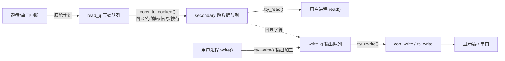

# tty_io.c 到底在干什么

`kernel/tty_io.c` 是 linux-0.01 的 **tty（终端）核心层**。

## 一句话定位

它是**用户进程读写终端**和**底层硬件（键盘/显示器/串口）**之间的**中间层**：
向上给 `read()/write()` 提供统一的字符收发接口，向下对接控制台和串口驱动，
中间负责**行编辑、回显、信号、换行转换**这些"终端规矩"。

```c
/*
 * 'tty_io.c' gives an orthogonal feeling to tty's, be they consoles
 * or rs-channels. It also implements echoing, cooked mode etc
 */
```

"orthogonal feeling" = 不管底层是控制台还是串口，上层都用同一套方式对待。

## 它管理的 3 个终端

`tty_table` 定义了 3 个 tty，每个带自己的参数和输出函数：

```c
struct tty_struct tty_table[] = {
	{ ... con_write, ...},         /* [0] 控制台：键盘+显示器 */
	{ ... rs_write, {0x3f8,...}},  /* [1] 串口 COM1 */
	{ ... rs_write, {0x2f8,...}},  /* [2] 串口 COM2 */
};
```

每个 tty 有三个队列：`read_q`（原始输入）、`secondary`（处理后的"熟"数据）、
`write_q`（待输出），和一个 `write` 函数指针（控制台用 `con_write`，串口用 `rs_write`）。

## 关键：三个队列构成的数据流

理解这个文件，核心是看懂**输入和输出两条路**，中枢是 `read_q → secondary → write_q` 这三个队列。

### 输入路径（你敲键盘 → 程序读到）

1. 键盘中断把原始字符放进 `read_q`；
2. 中断底半部调用 `do_tty_interrupt` → `copy_to_cooked()`，把 `read_q` 的原始字符**加工**后放进 `secondary`；
3. 用户进程调用的 `tty_read()` 从 `secondary` 取字符给程序。

`copy_to_cooked()` 是这个文件最核心的函数，它实现了所谓 **cooked / canonical（行规程）** 模式
——把"原始按键"变成"一行行可用的文本"：

```c
void copy_to_cooked(struct tty_struct * tty)
{
	while (!EMPTY(tty->read_q) && !FULL(tty->secondary)) {
		GETCH(tty->read_q,c);
		if (c==13) if (I_CRNL(tty)) c=10; ...        /* 回车/换行转换 */
		if (L_CANON(tty)) {
			if (c==ERASE_CHAR(tty)) { ... }          /* 退格删字符 */
			if (c==STOP_CHAR(tty)) ...               /* Ctrl-S 暂停 */
		}
		if (c==INTR_CHAR(tty)) tty_intr(tty,SIGINT); /* Ctrl-C 发信号 */
		if (L_ECHO(tty)) { ... PUTCH(c,tty->write_q); } /* 回显 */
		PUTCH(c,tty->secondary);
	}
	wake_up(&tty->secondary.proc_list);
}
```

它干的"终端规矩"包括：

- **换行转换**：CR↔LF 互转（`I_CRNL`/`I_NLCR` 等）；
- **行编辑**：退格键删除上一个字符（`ERASE_CHAR`）；
- **流控**：Ctrl-S/Ctrl-Q 暂停/恢复输出；
- **信号**：Ctrl-C → 给前台进程组发 `SIGINT`（`tty_intr`）；
- **回显（echo）**：把你敲的字符同时放进 `write_q` 显示出来——去掉 ECHO 就看不到输入。

### 输出路径（程序写 → 显示出来）

`tty_write()` 把用户缓冲区的字符放进 `write_q`，做输出加工（如 `\n` → `\r\n`），
再调用 `tty->write(tty)` 让底层驱动真正送到屏幕/串口：

```c
int tty_write(unsigned channel, char * buf, int nr)
{
	...
	if (c=='\n' && O_NLCR(tty)) { PUTCH(13,tty->write_q); ... } /* NL→CRNL */
	PUTCH(c,tty->write_q);
	tty->write(tty);   /* con_write 或 rs_write */
}
```

## 阻塞与唤醒

终端是慢速设备，所以这里大量用**睡眠/唤醒**：输入队列空了，`tty_read` 通过
`sleep_if_empty` 让进程睡下；来了新数据，`copy_to_cooked` 末尾 `wake_up` 唤醒它。
输出队列满了则 `sleep_if_full`。这让读写终端的进程在没数据时不空转、让出 CPU。

## 文件里各函数的角色

| 函数 | 作用 |
|---|---|
| `tty_init` | 初始化：调 `rs_init()`（串口）+ `con_init()`（控制台） |
| `copy_to_cooked` | **核心**：原始输入 → 熟数据，做回显/行编辑/信号/换行转换 |
| `tty_read` | 系统调用 `read` 的终端实现，从 `secondary` 读 |
| `tty_write` | 系统调用 `write` 的终端实现，写入 `write_q` 并驱动输出 |
| `do_tty_interrupt` | 中断里调用，触发 `copy_to_cooked` |
| `tty_intr` | 向前台进程组发信号（如 Ctrl-C → SIGINT） |
| `sleep_if_empty/full` | 队列空/满时让进程睡眠等待 |

## 数据流图



## 小结

`tty_io.c` 是 linux-0.01 的**终端抽象层**，核心职责有三：

1. **统一抽象**：用 `tty_table` + 函数指针，让控制台和串口在上层看来一模一样；
2. **行规程（cooked 模式）**：`copy_to_cooked()` 把零散按键加工成规整文本——回显、退格编辑、
   Ctrl-C 发信号、Ctrl-S 流控、CR/LF 换行转换都在这里；
3. **连接系统调用与硬件**：`tty_read/tty_write` 是 `read()/write()` 对终端的实现，
   底层经 `con_write/rs_write` 落到屏幕/串口，并用队列 + 睡眠/唤醒处理慢速设备的阻塞。

一句话：**它是键盘/屏幕和用户程序之间那层"懂终端规矩"的翻译官**。
