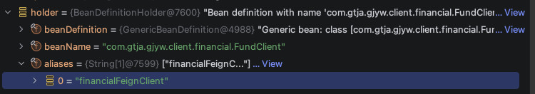

# 一文精通 Spring BeanDefinition 注册
{docsify-updated}

前边两篇文章我们详细介绍了 `BeanFactory` 与 `ApplicationContext` 的实现，本篇文章我们来详细介绍一下 Spring 扫描注册 `BeanDefinition` 的过程。

## BeanDefinition
描述一个 bean 的元数据信息，比如 `class` 类型 , `scope` , `name` , `isLazyInit` 等信息。
```
public interface BeanDefinition extends AttributeAccessor, BeanMetadataElement {...}

public abstract class AbstractBeanDefinition extends BeanMetadataAttributeAccessor
		implements BeanDefinition, Cloneable {...}

public class RootBeanDefinition extends AbstractBeanDefinition {...}

public class AnnotatedGenericBeanDefinition extends GenericBeanDefinition implements AnnotatedBeanDefinition {...}

public class ScannedGenericBeanDefinition extends GenericBeanDefinition implements AnnotatedBeanDefinition {...}
```

## BeanDefinitionRegistry
保存、注册、获取等管理 `BeanDefinition` 元信息的接口：
```
public interface BeanDefinitionRegistry extends AliasRegistry {
    void registerBeanDefinition(String beanName, BeanDefinition beanDefinition)
			throws BeanDefinitionStoreException;
    void removeBeanDefinition(String beanName) throws NoSuchBeanDefinitionException;
    BeanDefinition getBeanDefinition(String beanName) throws NoSuchBeanDefinitionException;
    ...
}
```

## ApplicationContext 的构造
Springboot 默认创建的 `ApplicationContext` 是 `AnnotationConfigServletWebServerApplicationContext` .
`AnnotationConfigApplicationContext`/`AnnotationConfigServletWebServerApplicationContext` 的构造函数中都会创建 `AnnotatedBeanDefinitionReader/ClassPathBeanDefinitionScanner` 来读取 `BeanDefinition` 。并且都会在构造函数中直接 `new` 这些对象：
```
AnnotationConfigApplicationContext

public AnnotationConfigApplicationContext(String... basePackages) {
    this();
    scan(basePackages);
    refresh();
}

public AnnotationConfigApplicationContext() {
    this.reader = new AnnotatedBeanDefinitionReader(this);
    this.scanner = new ClassPathBeanDefinitionScanner(this);
}


AnnotationConfigServletWebServerApplicationContext
public AnnotationConfigServletWebServerApplicationContext() {
    this.reader = new AnnotatedBeanDefinitionReader(this);
    this.scanner = new ClassPathBeanDefinitionScanner(this);
}
```

## AnnotatedBeanDefinitionReader
以下是 `AnnotatedBeanDefinitionReader` 的构造函数：
```
public AnnotatedBeanDefinitionReader(BeanDefinitionRegistry registry, Environment environment) {
    Assert.notNull(registry, "BeanDefinitionRegistry must not be null");
    Assert.notNull(environment, "Environment must not be null");
    this.registry = registry;
    this.conditionEvaluator = new ConditionEvaluator(registry, environment, null);
    AnnotationConfigUtils.registerAnnotationConfigProcessors(this.registry);
}
```

构造函数中主要实现了两个功能：
1. 实例化了 `ConditionEvaluator` 对象，该对象用于评估 `@Conditional` 注解的条件是否满足。
2. 调用了 `AnnotationConfigUtils.registerAnnotationConfigProcessors(this.registry)` 方法，该方法会向 `BeanDefinitionRegistry` 中注册一些 `BeanFactoryPostProcessor` 、`BeanPostProcessor` 等。

`AnnotationConfigUtils.registerAnnotationConfigProcessors(this.registry)` 方法如下：
```
public static Set<BeanDefinitionHolder> registerAnnotationConfigProcessors(
        BeanDefinitionRegistry registry, @Nullable Object source) {

    DefaultListableBeanFactory beanFactory = unwrapDefaultListableBeanFactory(registry);
    if (beanFactory != null) {
        if (!(beanFactory.getDependencyComparator() instanceof AnnotationAwareOrderComparator)) {
            beanFactory.setDependencyComparator(AnnotationAwareOrderComparator.INSTANCE);
        }
        if (!(beanFactory.getAutowireCandidateResolver() instanceof ContextAnnotationAutowireCandidateResolver)) {
            beanFactory.setAutowireCandidateResolver(new ContextAnnotationAutowireCandidateResolver());
        }
    }

    Set<BeanDefinitionHolder> beanDefs = CollectionUtils.newLinkedHashSet(6);

    if (!registry.containsBeanDefinition(CONFIGURATION_ANNOTATION_PROCESSOR_BEAN_NAME)) {
        RootBeanDefinition def = new RootBeanDefinition(ConfigurationClassPostProcessor.class);
        def.setSource(source);
        beanDefs.add(registerPostProcessor(registry, def, CONFIGURATION_ANNOTATION_PROCESSOR_BEAN_NAME));
    }

    if (!registry.containsBeanDefinition(AUTOWIRED_ANNOTATION_PROCESSOR_BEAN_NAME)) {
        RootBeanDefinition def = new RootBeanDefinition(AutowiredAnnotationBeanPostProcessor.class);
        def.setSource(source);
        beanDefs.add(registerPostProcessor(registry, def, AUTOWIRED_ANNOTATION_PROCESSOR_BEAN_NAME));
    }

    // Check for Jakarta Annotations support, and if present add the CommonAnnotationBeanPostProcessor.
    if (JAKARTA_ANNOTATIONS_PRESENT && !registry.containsBeanDefinition(COMMON_ANNOTATION_PROCESSOR_BEAN_NAME)) {
        RootBeanDefinition def = new RootBeanDefinition(CommonAnnotationBeanPostProcessor.class);
        def.setSource(source);
        beanDefs.add(registerPostProcessor(registry, def, COMMON_ANNOTATION_PROCESSOR_BEAN_NAME));
    }

    // Check for JPA support, and if present add the PersistenceAnnotationBeanPostProcessor.
    if (JPA_PRESENT && !registry.containsBeanDefinition(PERSISTENCE_ANNOTATION_PROCESSOR_BEAN_NAME)) {
        RootBeanDefinition def = new RootBeanDefinition();
        try {
            def.setBeanClass(ClassUtils.forName(PERSISTENCE_ANNOTATION_PROCESSOR_CLASS_NAME,
                    AnnotationConfigUtils.class.getClassLoader()));
        }
        catch (ClassNotFoundException ex) {
            throw new IllegalStateException(
                    "Cannot load optional framework class: " + PERSISTENCE_ANNOTATION_PROCESSOR_CLASS_NAME, ex);
        }
        def.setSource(source);
        beanDefs.add(registerPostProcessor(registry, def, PERSISTENCE_ANNOTATION_PROCESSOR_BEAN_NAME));
    }

    if (!registry.containsBeanDefinition(EVENT_LISTENER_PROCESSOR_BEAN_NAME)) {
        RootBeanDefinition def = new RootBeanDefinition(EventListenerMethodProcessor.class);
        def.setSource(source);
        beanDefs.add(registerPostProcessor(registry, def, EVENT_LISTENER_PROCESSOR_BEAN_NAME));
    }

    if (!registry.containsBeanDefinition(EVENT_LISTENER_FACTORY_BEAN_NAME)) {
        RootBeanDefinition def = new RootBeanDefinition(DefaultEventListenerFactory.class);
        def.setSource(source);
        beanDefs.add(registerPostProcessor(registry, def, EVENT_LISTENER_FACTORY_BEAN_NAME));
    }

    return beanDefs;
}
```
总结下来， `AnnotationConfigUtils.registerAnnotationConfigProcessors(this.registry)` 方法会视情况向 `BeanDefinitionRegistry` 中注册以下 `BeanDefinition` ：
1. `org.springframework.context.annotation.internalConfigurationAnnotationProcessor` -> `ConfigurationClassPostProcessor` : 处理 `@Configuration` 的配置类，`@Bean` 、`@Import` 、`@ImportResource` 、`@ComponentScan` 等注解也会被它处理，另外会将 `@PropertySource` 注解的属性文件加载到 `Environment` 中。
2. `org.springframework.context.annotation.internalAutowiredAnnotationProcessor` -> `AutowiredAnnotationBeanPostProcessor` : 处理 `@Autowired` 、`@Value` 、 `@Injec` 等注解
3. `org.springframework.context.annotation.internalCommonAnnotationProcessor` -> `CommonAnnotationBeanPostProcessor` : 处理 `jakarta.annotation` 包下的注解， 如 `@Resource` 、`@PostConstruct` 、`@PreDestroy` 等注解
4. `org.springframework.context.annotation.internalPersistenceAnnotationProcessor` -> `PersistenceAnnotationBeanPostProcessor` : 处理 JPA 相关注解，如果添加了 JPA 依赖
5. `org.springframework.context.event.internalEventListenerProcessor` -> `EventListenerMethodProcessor` : 处理 `@EventListener` 注解
6. `org.springframework.context.event.internalEventListenerFactory` -> `DefaultEventListenerFactory` : 与 `EventListenerMethodProcessor` 搭配使用支持事件机制

如下图，就是在 `AbstractApplicationContext` 的 `refresh()` 开始执行时，注册的 `BeanDefinition` ：

<center></center>

+ `ConfigurationClassPostProcessor` ，是一个 用于处理 `@Configuration` 注解类的 `BeanFactoryPostProcessor` 。
+ `AutowiredAnnotationBeanPostProcessor` ，是一个 `BeanPostProcessor` ，用于处理 `@Autowired` 、`@Value` 、 `@Injec` 等注解
+ `CommonAnnotationBeanPostProcessor` ，是一个 `BeanPostProcessor` ，用于处理 `@Resource` 、`@PostConstruct` 、`@PreDestroy` 等注解
+ `PersistenceAnnotationBeanPostProcessor` ，是一个 `BeanPostProcessor` ，用于处理 JPA 相关注解，如果添加了 JPA 依赖

其中 `ConfigurationClassPostProcessor` 是一个 `BeanFactoryPostProcessor` ,结合前文的分析， `ApplicationContext` 在 `refresh()` 时会调用 `invokeBeanFactoryPostProcessors()` 方法来调用 `BeanFactoryPostProcessor` 的 `postProcessBeanFactory()` 方法。 `ConfigurationClassPostProcessor` 的主要作用就是在 `postProcessBeanFactory()` 方法中调用 `processConfigBeanDefinitions()` 方法来处理 `@Configuration` 注解的配置类，`@Bean` 、`@Import` 、`@ImportResource` 、`@ComponentScan` 等注解也会被它处理，另外会将 `@PropertySource` 注解的属性文件加载到 `Environment` 中。处理这些注解的过程中，就会向容器中注册大量的 `BeanDefinition` 。


### ConfigurationClassPostProcessor

`ConfigurationClassUtils` 会找出需要处理的配置类： `@Component` `@ComponentScan` `@Import` `@ImportResource` 注解的类都会被处理，另外如果 `BeanDefinitio` 中有 `@Bean` 方法也会被处理。所以， `@Component` 中的 `@Bean` 也可以注册 bean .

```
public class ConfigurationClassPostProcessor implements BeanDefinitionRegistryPostProcessor,
		BeanRegistrationAotProcessor, BeanFactoryInitializationAotProcessor, PriorityOrdered,
		ResourceLoaderAware, ApplicationStartupAware, BeanClassLoaderAware, EnvironmentAware {...}

ConfigurationClassPostProcessor.postProcessBeanDefinitionRegistry()
    └─ processConfigBeanDefinitions()
        ├─ ConfigurationClassParser.parse()             ← 解析阶段
        │   └─ processImports()
        │       └─ 遇到 ImportBeanDefinitionRegistrar：
        │           ├─ new Registrar() + 注入 Aware
        │           └─ configClass.addImportBeanDefinitionRegistrar(...)   ← 暂存
        │
        └─ ConfigurationClassBeanDefinitionReader.loadBeanDefinitions()   ← 注册阶段
            └─ loadBeanDefinitionsForConfigurationClass(每个 configClass)
                └─ loadBeanDefinitionsFromRegistrars(...)
                    └─ registrar.registerBeanDefinitions(metadata, registry, ...)   ← 👈 调你的代码
```


#### ConfigurationClassParser
```
protected final @Nullable SourceClass doProcessConfigurationClass(
        ConfigurationClass configClass, SourceClass sourceClass, Predicate<String> filter)
        throws IOException {

    if (configClass.getMetadata().isAnnotated(Component.class.getName())) {
        // Recursively process any member (nested) classes first
        processMemberClasses(configClass, sourceClass, filter);
    }

    // Process any @PropertySource annotations
    for (AnnotationAttributes propertySource : AnnotationConfigUtils.attributesForRepeatable(
            sourceClass.getMetadata(), org.springframework.context.annotation.PropertySource.class,
            PropertySources.class, true)) {
        if (this.propertySourceRegistry != null) {
            this.propertySourceRegistry.processPropertySource(propertySource);
        }
       .....
    }

    // Search for locally declared @ComponentScan annotations first.
    Set<AnnotationAttributes> componentScans = AnnotationConfigUtils.attributesForRepeatable(
            sourceClass.getMetadata(), ComponentScan.class, ComponentScans.class,
            MergedAnnotation::isDirectlyPresent);

    // Fall back to searching for @ComponentScan meta-annotations (which indirectly
    // includes locally declared composed annotations).
    if (componentScans.isEmpty()) {
        componentScans = AnnotationConfigUtils.attributesForRepeatable(sourceClass.getMetadata(),
                ComponentScan.class, ComponentScans.class, MergedAnnotation::isMetaPresent);
    }

    if (!componentScans.isEmpty()) {
        List<Condition> registerBeanConditions = collectRegisterBeanConditions(configClass);
        if (!registerBeanConditions.isEmpty()) {
            .....
        }
        for (AnnotationAttributes componentScan : componentScans) {
            // The config class is annotated with @ComponentScan -> perform the scan immediately
            Set<BeanDefinitionHolder> scannedBeanDefinitions =
                    this.componentScanParser.parse(componentScan, sourceClass.getMetadata().getClassName());
            // Check the set of scanned definitions for any further config classes and parse recursively if needed
            for (BeanDefinitionHolder holder : scannedBeanDefinitions) {
                BeanDefinition bdCand = holder.getBeanDefinition().getOriginatingBeanDefinition();
                if (bdCand == null) {
                    bdCand = holder.getBeanDefinition();
                }
                if (ConfigurationClassUtils.checkConfigurationClassCandidate(bdCand, this.metadataReaderFactory)) {
                    parse(bdCand.getBeanClassName(), holder.getBeanName());
                }
            }
        }
    }

    // Process any @Import annotations
    processImports(configClass, sourceClass, getImports(sourceClass), filter, true);

    // Process any @ImportResource annotations
    AnnotationAttributes importResource =
            AnnotationConfigUtils.attributesFor(sourceClass.getMetadata(), ImportResource.class);
    if (importResource != null) {
        String[] resources = importResource.getStringArray("locations");
        Class<? extends BeanDefinitionReader> readerClass = importResource.getClass("reader");
        for (String resource : resources) {
            String resolvedResource = this.environment.resolveRequiredPlaceholders(resource);
            configClass.addImportedResource(resolvedResource, readerClass);
        }
    }

    // Process individual @Bean methods
    Set<MethodMetadata> beanMethods = retrieveBeanMethodMetadata(sourceClass);
    for (MethodMetadata methodMetadata : beanMethods) {
        if (methodMetadata.isAnnotated("kotlin.jvm.JvmStatic") && !methodMetadata.isStatic()) {
            continue;
        }
        configClass.addBeanMethod(new BeanMethod(methodMetadata, configClass));
    }

    // Process default methods on interfaces
    processInterfaces(configClass, sourceClass);

    // Process superclass, if any
    if (sourceClass.getMetadata().hasSuperClass()) {
        String superclass = sourceClass.getMetadata().getSuperClassName();
        if (superclass != null && !superclass.startsWith("java")) {
            boolean superclassKnown = this.knownSuperclasses.containsKey(superclass);
            this.knownSuperclasses.add(superclass, configClass);
            if (!superclassKnown) {
                // Superclass found, return its annotation metadata and recurse
                return sourceClass.getSuperClass();
            }
        }
    }

    // No superclass -> processing is complete
    return null;
}
```

1. 处理 `@PropertySource` 注解
2. 处理 `@ComponentScan` 注解，使用 `ComponentScanAnnotationParser -> ClassPathBeanDefinitionScanner` 扫描组件，注册 `BeanDefinition`.默认扫描标注了 `@ComponentScan` 注解类所在的包
3. `processImports(...)` 处理 `@Import` 注解
4. 处理 `@ImportResource` 注解
5. 处理 `@Bean` 注解


##### @Import 注解
```
@Target(ElementType.TYPE)
@Retention(RetentionPolicy.RUNTIME)
@Documented
public @interface Import {

	/**
	 * {@link Configuration @Configuration}, {@link ImportSelector},
	 * {@link ImportBeanDefinitionRegistrar}, {@link BeanRegistrar}, or regular
	 * component classes to import.
	 */
	Class<?>[] value();

}
```

`ConfigurationClassParser` 中处理 `@Import` 的代码如下：
```
private void processImports(ConfigurationClass configClass, SourceClass currentSourceClass,
        Collection<SourceClass> importCandidates, Predicate<String> filter, boolean checkForCircularImports) {

    if (importCandidates.isEmpty()) {
        return;
    }

    if (checkForCircularImports && isChainedImportOnStack(configClass)) {
        this.problemReporter.error(new CircularImportProblem(configClass, this.importStack));
    }
    else {
        this.importStack.push(configClass);
        try {
            for (SourceClass candidate : importCandidates) {
                if (candidate.isAssignable(ImportSelector.class)) {
                    // Candidate class is an ImportSelector -> delegate to it to determine imports
                    Class<?> candidateClass = candidate.loadClass();
                    ImportSelector selector = ParserStrategyUtils.instantiateClass(candidateClass, ImportSelector.class,
                            this.environment, this.resourceLoader, this.registry);
                    Predicate<String> selectorFilter = selector.getExclusionFilter();
                    if (selectorFilter != null) {
                        filter = filter.or(selectorFilter);
                    }
                    if (selector instanceof DeferredImportSelector deferredImportSelector) {
                        this.deferredImportSelectorHandler.handle(configClass, deferredImportSelector);
                    }
                    else {
                        String[] importClassNames = selector.selectImports(currentSourceClass.getMetadata());
                        Collection<SourceClass> importSourceClasses = asSourceClasses(importClassNames, filter);
                        processImports(configClass, currentSourceClass, importSourceClasses, filter, false);
                    }
                }
                else if (candidate.isAssignable(BeanRegistrar.class)) {
                    Class<?> candidateClass = candidate.loadClass();
                    BeanRegistrar registrar = (BeanRegistrar) BeanUtils.instantiateClass(candidateClass);
                    AnnotationMetadata metadata = currentSourceClass.getMetadata();
                    if (registrar instanceof ImportAware importAware) {
                        importAware.setImportMetadata(metadata);
                    }
                    configClass.addBeanRegistrar(metadata.getClassName(), registrar);
                }
                else if (candidate.isAssignable(ImportBeanDefinitionRegistrar.class)) {
                    // Candidate class is an ImportBeanDefinitionRegistrar ->
                    // delegate to it to register additional bean definitions
                    Class<?> candidateClass = candidate.loadClass();
                    ImportBeanDefinitionRegistrar registrar =
                            ParserStrategyUtils.instantiateClass(candidateClass, ImportBeanDefinitionRegistrar.class,
                                    this.environment, this.resourceLoader, this.registry);
                    configClass.addImportBeanDefinitionRegistrar(registrar, currentSourceClass.getMetadata());
                }
                else {
                    // Candidate class not an ImportSelector or ImportBeanDefinitionRegistrar ->
                    // process it as an @Configuration class
                    this.importStack.registerImport(
                            currentSourceClass.getMetadata(), candidate.getMetadata().getClassName());
                    processConfigurationClass(candidate.asConfigClass(configClass), filter);
                }
            }
        }
        ....
        finally {
            this.importStack.pop();
        }
    }
}
```

以上代码可以看出，分别处理了 `@Import` 导入的 `ImportSelector` 、`BeanRegistrar` 、`ImportBeanDefinitionRegistrar` 、其它 `@Configuration` 配置类的场景。


##### ConfigurationClassParser 总结
`ConfigurationClassParser` 只是解析 `@Configuration` 标注的配置类，将其解析成 `ConfigurationClass` 中各个字段的配置：
```
final class ConfigurationClass {

	private final AnnotationMetadata metadata;

	private final Resource resource;

	@Nullable
	private String beanName;

	private boolean scanned = false;

	private final Set<ConfigurationClass> importedBy = new LinkedHashSet<>(1);

	private final Set<BeanMethod> beanMethods = new LinkedHashSet<>(); // @Bean 标注的方法

	private final Map<String, Class<? extends BeanDefinitionReader>> importedResources =
			new LinkedHashMap<>();

	private final Map<ImportBeanDefinitionRegistrar, AnnotationMetadata> importBeanDefinitionRegistrars =
			new LinkedHashMap<>(); // @Import 导入的 ImportBeanDefinitionRegistrar

	final Set<String> skippedBeanMethods = new HashSet<>();
    ....
}
```
真正从配置类 `ConfigurationClass` 对象中加载 `BeanDefinition` 到 `BeanFactory` 中的是 `ConfigurationClassBeanDefinitionReader` 。

#### ConfigurationClassBeanDefinitionReader
`ConfigurationClassBeanDefinitionReader` 负责根据 `ConfigurationClass` 对象中的属性值，加载 `BeanDefinition` 到 `BeanFactory` 中。

```
public void loadBeanDefinitions(Set<ConfigurationClass> configurationModel) {
    TrackedConditionEvaluator trackedConditionEvaluator = new TrackedConditionEvaluator();
    for (ConfigurationClass configClass : configurationModel) {
        loadBeanDefinitionsForConfigurationClass(configClass, trackedConditionEvaluator);
    }
}

private void loadBeanDefinitionsForConfigurationClass(
        ConfigurationClass configClass, TrackedConditionEvaluator trackedConditionEvaluator) {

    if (trackedConditionEvaluator.shouldSkip(configClass)) {
        String beanName = configClass.getBeanName();
        if (StringUtils.hasLength(beanName) && this.registry.containsBeanDefinition(beanName)) {
            this.registry.removeBeanDefinition(beanName);
        }
        this.importRegistry.removeImportingClass(configClass.getMetadata().getClassName());
        return;
    }

    if (configClass.isImported()) {
        registerBeanDefinitionForImportedConfigurationClass(configClass);
    }
    for (BeanMethod beanMethod : configClass.getBeanMethods()) {
        loadBeanDefinitionsForBeanMethod(beanMethod);
    }

    loadBeanDefinitionsFromImportedResources(configClass.getImportedResources());
    loadBeanDefinitionsFromRegistrars(configClass.getImportBeanDefinitionRegistrars());
}
```

### Spring提供的实用工具类
+ `BeanDefinitionBuilder` ：Programmatic means of constructing BeanDefinitions using the builder pattern. Intended primarily for use when implementing Spring 2.0 NamespaceHandlers.
+ `ClassPathScanningCandidateComponentProvider` : 自定义的 bean 扫描器，比如 `Feign` 就是用它扫描 bean
    ```
    LinkedHashSet<BeanDefinition> candidateComponents = new LinkedHashSet<>();
    ClassPathScanningCandidateComponentProvider scanner = getScanner();
    scanner.setResourceLoader(this.resourceLoader);
    scanner.addIncludeFilter(new AnnotationTypeFilter(FeignClient.class));
    Set<String> basePackages = getBasePackages(metadata);
    Set<String> basePackages = getBasePackages(metadata);
    for (String basePackage : basePackages) {
        candidateComponents.addAll(scanner.findCandidateComponents(basePackage));
    }
    ```
+ `AnnotationConfigUtils` : 
+ `ClassPathBeanDefinitionScanner` :继承自 `ClassPathScanningCandidateComponentProvider`, 一个 Bean 定义扫描器，用于在类路径（classpath）上检测候选 Bean，并将对应的 `BeanDefinition` 注册到指定的注册表中（如 `BeanFactory` 或 `ApplicationContext` ）。
    候选类通过可配置的类型过滤器（type filters）进行检测。默认情况下，过滤器会包含那些被 Spring stereotype 注解标记的类，例如：
    ```
    @Component
    @Repository
    @Service
    @Controller
    ```
    也就是说，默认会自动扫描并注册这些注解标识的类为 Spring Bean。 使用这个工具类能方便的扫描出 classpath 下指定条件的 bean 。

### 实例分析
#### ImportBeanDefinitionRegistrar 的实例
```
@EnableAspectJAutoProxy → AspectJAutoProxyRegistrar
@EnableTransactionManagement → TransactionManagementConfigurationSelector（用 ImportSelector，但底层结合 Registrar）
@EnableFeignClients → FeignClientsRegistrar
@EnableConfigurationProperties → EnableConfigurationPropertiesRegistrar
@MapperScan → MapperScannerRegistrar (注册 MapperScannerConfigurer )
Spring Data 的 @Enable*Repositories → *RepositoriesRegistrar
```

1. 它是单例 + 无状态的临时对象： `Registrar` 由 `new` 实例化，不进入 Spring 容器，用完就丢。所以不要在 `Registrar` 字段里存运行期状态。
2. 它能拿到 4 种"基础设施"，但拿不到完整 IoC
    通过两种方式注入：
    + 构造器注入：`public MyRegistrar(Environment env, BeanFactory bf, ClassLoader cl, ResourceLoader rl)` 任意组合
    + `Aware` 接口： `EnvironmentAware / BeanFactoryAware / BeanClassLoaderAware / ResourceLoaderAware`
    但拿不到其他 Bean 的实例（因为此时 Bean 都还没实例化）。
3. 不能在里面注册 `BeanDefinitionRegistryPostProcessor`
4. `Registrar` 的执行时机: 它在 `BeanFactoryPostProcessor` 阶段（具体说在 `BeanDefinitionRegistryPostProcessor` 阶段）执行，早于任何 Bean 的实例化。它注册的 `BeanDefinition` 也会被后续的 `BeanFactoryPostProcessor` （比如属性占位符解析）正常处理。

#### @EnableFeignClients → FeignClientsRegistrar 分析
```
public void registerFeignClients(AnnotationMetadata metadata, BeanDefinitionRegistry registry) {
    LinkedHashSet<BeanDefinition> candidateComponents = new LinkedHashSet<>();
    Map<String, Object> attrs = metadata.getAnnotationAttributes(EnableFeignClients.class.getName());
    final Class<?>[] clients = attrs == null ? null : (Class<?>[]) attrs.get("clients");
    if (clients == null || clients.length == 0) {
        ClassPathScanningCandidateComponentProvider scanner = getScanner();
        scanner.setResourceLoader(this.resourceLoader);
        scanner.addIncludeFilter(new AnnotationTypeFilter(FeignClient.class));
        Set<String> basePackages = getBasePackages(metadata);
        for (String basePackage : basePackages) {
            candidateComponents.addAll(scanner.findCandidateComponents(basePackage));
        }
    }
    else {
        for (Class<?> clazz : clients) {
            candidateComponents.add(new AnnotatedGenericBeanDefinition(clazz));
        }
    }

    for (BeanDefinition candidateComponent : candidateComponents) {
        if (candidateComponent instanceof AnnotatedBeanDefinition) {
            // verify annotated class is an interface
            AnnotatedBeanDefinition beanDefinition = (AnnotatedBeanDefinition) candidateComponent;
            AnnotationMetadata annotationMetadata = beanDefinition.getMetadata();
            Assert.isTrue(annotationMetadata.isInterface(), "@FeignClient can only be specified on an interface");

            Map<String, Object> attributes = annotationMetadata
                    .getAnnotationAttributes(FeignClient.class.getCanonicalName());

            String name = getClientName(attributes);
            registerClientConfiguration(registry, name, attributes.get("configuration"));

            registerFeignClient(registry, annotationMetadata, attributes);
        }
    }
}

private void registerFeignClient(BeanDefinitionRegistry registry, AnnotationMetadata annotationMetadata,
        Map<String, Object> attributes) {
    String className = annotationMetadata.getClassName();
    Class clazz = ClassUtils.resolveClassName(className, null);
    ConfigurableBeanFactory beanFactory = registry instanceof ConfigurableBeanFactory
            ? (ConfigurableBeanFactory) registry : null;
    String contextId = getContextId(beanFactory, attributes);
    String name = getName(attributes);
    FeignClientFactoryBean factoryBean = new FeignClientFactoryBean();
    factoryBean.setBeanFactory(beanFactory);
    factoryBean.setName(name);
    factoryBean.setContextId(contextId);
    factoryBean.setType(clazz);
    factoryBean.setRefreshableClient(isClientRefreshEnabled());
    BeanDefinitionBuilder definition = BeanDefinitionBuilder.genericBeanDefinition(clazz, () -> {
        factoryBean.setUrl(getUrl(beanFactory, attributes));
        factoryBean.setPath(getPath(beanFactory, attributes));
        factoryBean.setDecode404(Boolean.parseBoolean(String.valueOf(attributes.get("decode404"))));
        Object fallback = attributes.get("fallback");
        if (fallback != null) {
            factoryBean.setFallback(fallback instanceof Class ? (Class<?>) fallback
                    : ClassUtils.resolveClassName(fallback.toString(), null));
        }
        Object fallbackFactory = attributes.get("fallbackFactory");
        if (fallbackFactory != null) {
            factoryBean.setFallbackFactory(fallbackFactory instanceof Class ? (Class<?>) fallbackFactory
                    : ClassUtils.resolveClassName(fallbackFactory.toString(), null));
        }
        return factoryBean.getObject();
    });
    definition.setAutowireMode(AbstractBeanDefinition.AUTOWIRE_BY_TYPE);
    definition.setLazyInit(true);
    validate(attributes);

    AbstractBeanDefinition beanDefinition = definition.getBeanDefinition();
    beanDefinition.setAttribute(FactoryBean.OBJECT_TYPE_ATTRIBUTE, className);
    beanDefinition.setAttribute("feignClientsRegistrarFactoryBean", factoryBean);

    // has a default, won't be null
    boolean primary = (Boolean) attributes.get("primary");

    beanDefinition.setPrimary(primary);

    String[] qualifiers = getQualifiers(attributes);
    if (ObjectUtils.isEmpty(qualifiers)) {
        qualifiers = new String[] { contextId + "FeignClient" };
    }

    BeanDefinitionHolder holder = new BeanDefinitionHolder(beanDefinition, className, qualifiers);
    BeanDefinitionReaderUtils.registerBeanDefinition(holder, registry);

    registerOptionsBeanDefinition(registry, contextId);
}
```

大致过程就是扫描 `@FeignClient` 注解的类，然后根据注解的信息配置 `FeignClientFactoryBean`，然后生成一个 `BeanDefinition` ，为这个 `BeanDefinition` 设置 `instanceSupplier` 属性。 `Supplier` 就是使用 `FeignClientFactoryBean` 工厂来生成对象。

<center></center>

#### @MapperScan → MapperScannerRegistrar 分析
`MapperScannerRegistrar` 的 `registerBeanDefinitions` 方法：
```
void registerBeanDefinitions(AnnotationMetadata annoMeta, AnnotationAttributes annoAttrs,
    BeanDefinitionRegistry registry, String beanName) {

    BeanDefinitionBuilder builder = BeanDefinitionBuilder.genericBeanDefinition(MapperScannerConfigurer.class);
    builder.addPropertyValue("processPropertyPlaceHolders", true);
    ....
    registry.registerBeanDefinition(beanName, builder.getBeanDefinition());
}
```
这个方法的主要作用就是注册一个 `MapperScannerConfigurer` 的 `BeanDefinition` 到 `BeanFactory` 中。 `MapperScannerConfigurer` 是一个 `BeanDefinitionRegistryPostProcessor`，它会扫描指定包下的所有 `@Mapper` 注解的接口，然后为每个接口生成一个 `BeanDefinition`，并注册到 `BeanFactory` 中。其中，主要是用了 `ClassPathMapperScanner` 来扫描的。以下是 `MapperScannerConfigurer` 的 `postProcessBeanDefinitionRegistry` 方法：
```
@Override
public void postProcessBeanDefinitionRegistry(BeanDefinitionRegistry registry) {
    if (this.processPropertyPlaceHolders) {
        processPropertyPlaceHolders();
    }

    ClassPathMapperScanner scanner = new ClassPathMapperScanner(registry);
    scanner.setAddToConfig(this.addToConfig);
    scanner.setAnnotationClass(this.annotationClass);
    scanner.setMarkerInterface(this.markerInterface);
    scanner.setSqlSessionFactory(this.sqlSessionFactory);
    scanner.setSqlSessionTemplate(this.sqlSessionTemplate);
    scanner.setSqlSessionFactoryBeanName(this.sqlSessionFactoryBeanName);
    scanner.setSqlSessionTemplateBeanName(this.sqlSessionTemplateBeanName);
    scanner.setResourceLoader(this.applicationContext);
    scanner.setBeanNameGenerator(this.nameGenerator);
    scanner.setMapperFactoryBeanClass(this.mapperFactoryBeanClass);
    if (StringUtils.hasText(lazyInitialization)) {
        scanner.setLazyInitialization(Boolean.valueOf(lazyInitialization));
    }
    if (StringUtils.hasText(defaultScope)) {
        scanner.setDefaultScope(defaultScope);
    }
    scanner.registerFilters();
    scanner.scan(
        StringUtils.tokenizeToStringArray(this.basePackage, ConfigurableApplicationContext.CONFIG_LOCATION_DELIMITERS));
}
```

最终， `ClassPathMapperScanner.doScan()` 方法会把所有 `@Mapper` 注解的接口都注册为 `BeanDefinition` ，但是注册的类型是 `MapperFactoryBean` ：
```
@Override
public Set<BeanDefinitionHolder> doScan(String... basePackages) {
    Set<BeanDefinitionHolder> beanDefinitions = super.doScan(basePackages);

    if (beanDefinitions.isEmpty()) {
        LOGGER.warn(() -> "No MyBatis mapper was found in '" + Arrays.toString(basePackages)
            + "' package. Please check your configuration.");
    } else {
        processBeanDefinitions(beanDefinitions);
    }

    return beanDefinitions;
}
```

#### 总结
通过以上两个实例，我们发现 `Feign` 和 `Mybatis` 都使用了 `ImportBeanDefinitionRegistrar` 来注册 `BeanDefinition` 到 `BeanFactory` 中。但是有一些小小的差异就是 `Feign` 在 `ImportBeanDefinitionRegistrar` 中直接扫描 `@FeignClient` 注解的类，然后生成 `BeanDefinition` 注册到 `BeanFactory` 中。  

而 `Mybatis` 则是注册了一个 `MapperScannerConfigurer` 的 `BeanDefinitionRegistryPostProcessor` 类型到 `BeanFactory` 中，然后由 `MapperScannerConfigurer` 来扫描 `@Mapper` 注解的类，然后生成 `BeanDefinition` 注册到 `BeanFactory` 中。  

类似地，两者都使用了工厂来创建 bean 实例，分别是用了 `FeignClientFactoryBean` 和 `MapperFactoryBean` 。

### ClassPathBeanDefinitionScanner
官方 java doc:
```
A bean definition scanner that detects bean candidates on the classpath, registering corresponding bean definitions with a given registry (BeanFactory or ApplicationContext).
Candidate classes are detected through configurable type filters. The default filters include classes that are annotated or meta-annotated with Spring's @Component annotation, such as the @Repository, @Service, and @Controller stereotypes.
```

翻译过来就是会扫描类路径下 `@Component` 注解的类，将他们注册到容器中。注意， `@Component` 是 `@Repository` 、 `@Service` 、 `@Controller` 的父注解，所以默认情况下， `ClassPathBeanDefinitionScanner` 会扫描这些到注解的类。

另外， `@Configuration` 注解也标注了 `@Component` 注解，所以也会被扫描并注册到容器中，这里需要强调的是： `ClassPathBeanDefinitionScanner` 负责将 `@Configuration` 注解的类注册到容器中，但是它**不会**去解析 `@Bean` 方法或 `@Import` 等注解，这是由 `ConfigurationClassPostProcessor` 负责的。 `ClassPathBeanDefinitionScanner` 负责将 `@Configuration` 注解的类注册到容器中， `ConfigurationClassPostProcessor` 从容器中找出这些类并完成上述的解析过程。


## Springboot自动配置原理

```Java
@Target(ElementType.TYPE)
@Retention(RetentionPolicy.RUNTIME)
@Documented
@Inherited
@SpringBootConfiguration
@EnableAutoConfiguration
@ComponentScan(excludeFilters = { @Filter(type = FilterType.CUSTOM, classes = TypeExcludeFilter.class),
		@Filter(type = FilterType.CUSTOM, classes = AutoConfigurationExcludeFilter.class) })
public @interface SpringBootApplication {
    ....
}

@Target(ElementType.TYPE)
@Retention(RetentionPolicy.RUNTIME)
@Documented
@Inherited
@AutoConfigurationPackage
@Import(AutoConfigurationImportSelector.class)
public @interface EnableAutoConfiguration {
    ...
}

@Target(ElementType.TYPE)
@Retention(RetentionPolicy.RUNTIME)
@Documented
@Inherited
@Import(AutoConfigurationPackages.Registrar.class)
public @interface AutoConfigurationPackage {
    ....
}
```

<center></center>

通过 `@SpringBootApplication`注解， `AutoConfigurationImportSelector` 和 `AutoConfigurationPackages.Registrar` 被 `@Import` 导入。

Springboot 中的`AutoConfigurationImportSelector`（委托 `ImportCandidates` 真正实现）会检查发布的 jar 中的 `META-INF/spring/org.springframework.boot.autoconfigure.AutoConfiguration.imports` 文件。

<center></center>

该文件应列出配置类，每行一个类名，如下例所示：
```
com.mycorp.libx.autoconfigure.LibXAutoConfiguration
com.mycorp.libx.autoconfigure.LibXWebAutoConfiguration
```
这些类中往往使用了 `@Conditional` 等注解实现了自定义的自动配置。以下是一个简单的 Springboot 项目，导入了81 个自动配置类：

<center></center>

spring-boot-autoconfigure-4.1.2.jar 中的 `META-INF/spring/org.springframework.boot.autoconfigure.AutoConfiguration.imports` 文件内容如下：
```
org.springframework.boot.autoconfigure.admin.SpringApplicationAdminJmxAutoConfiguration
org.springframework.boot.autoconfigure.aop.AopAutoConfiguration
org.springframework.boot.autoconfigure.availability.ApplicationAvailabilityAutoConfiguration
org.springframework.boot.autoconfigure.context.ConfigurationPropertiesAutoConfiguration
org.springframework.boot.autoconfigure.context.LifecycleAutoConfiguration
org.springframework.boot.autoconfigure.context.MessageSourceAutoConfiguration
org.springframework.boot.autoconfigure.context.PropertyPlaceholderAutoConfiguration
org.springframework.boot.autoconfigure.info.ProjectInfoAutoConfiguration
org.springframework.boot.autoconfigure.jmx.JmxAutoConfiguration
org.springframework.boot.autoconfigure.ssl.SslAutoConfiguration
org.springframework.boot.autoconfigure.task.TaskExecutionAutoConfiguration
org.springframework.boot.autoconfigure.task.TaskSchedulingAutoConfiguration
```

自动配置必须通过在导入文件中命名的方式加载。确保它们被定义在特定的包空间中，并且永远不会成为组件扫描的目标。此外，自动配置类不应允许组件扫描查找其他组件,应使用特定的 `@Import` 注解来代替。

也就是说自动配置类不应该处于应用程序自动扫描的包路径下，否则就会被重复加载。而前文说的 `ClassPathBeanDefinitionScanner` 通常只会扫描 `@SpringBootApplication` 注解类所在的包路径，不会扫描到自动配置类。也不应该允许自动配置类被扫描到。